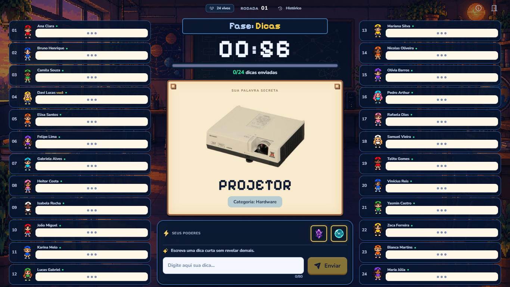

# Validação — Impostor TI

## Poderes e até três impostores — 18/10/2026

- TypeScript, **63/63 testes** e builds do frontend e servidor aprovados localmente.
- Novos testes cobrem os dez poderes, recargas, tentativa fracassada, barreiras, escudo de uso único, reescrita com silêncio, dicas falsas, votos dobrados e impedidos, 1–3 impostores, privacidade, reconexão e reenvio idempotente.
- Integração real com 24 alunos, professor e telão verifica 24 ativações simultâneas, absorção de ataques, notificações anônimas e restauração sem cobrança duplicada.
- Navegador local: os dez poderes ativados pela interface, escolha obrigatória de dois poderes, três impostores selecionados pelo professor, aliados privados, rascunho preservado, voto no celular, escudo impedindo eliminação, imagem oculta na próxima rodada e vitória após eliminar os três impostores.
- Layouts 1366×768 e 390×844, sem transbordamento horizontal, imagens quebradas ou erros de console. Campo de escrita visível nos dois tamanhos. Relatório local: `qa-evidence/powers/local-browser-report.json`.
- A publicação e a nova sessão pública de 30 minutos serão registradas abaixo após sua conclusão. A carga histórica de 17/10 não valida os poderes desta versão.

## Validação histórica — versão sem poderes

Verificações concluídas em **17/10/2026**. Frontend verificado: `ae3f467`; backend: `44a1092`, com `/health` configurado no Render. Este registro histórico se refere à versão anterior aos poderes.

## Código e integração

- `npm run check`: aprovado.
- `npm test`: **27/27 testes aprovados**, incluindo uma integração com 24 alunos, professor e telão em conexões Socket.IO reais.
- Builds do servidor e frontend: aprovados localmente e no GitHub Actions.
- `render.yaml`: aprovado pelo JSON Schema oficial do Render, usando Ajv 2020. O CLI do Render não estava instalado; não foi executada validação por CLI.
- A integração verificou palavra, ID e imagem ausentes das mensagens privadas do impostor e das mensagens do telão antes do resultado; votos secretos e únicos; proibição de voto próprio e comandos administrativos de aluno/telão; rejeição de origem WebSocket indevida; reconexão sem duplicação e nova partida.
- Testes de regras cobriram o prazo automático sem mensagens dos alunos, fim por todas as respostas, empate e desempate, continuidade após eliminar um civil, as duas vitórias, bloqueio de eliminados e idempotência.

## Sessão contínua no servidor público

Executada contra **https://impostor-ti-api.onrender.com**, com 24 alunos simulados, um professor e um telão: **26 conexões**. Intervalo: **17:57:24 a 18:27:45**, horário de Fortaleza (UTC−3).

| Medida                           |                    Resultado |
| -------------------------------- | ---------------------------: |
| Duração total                    | **30 minutos e 21 segundos** |
| Partidas completas               |                       **79** |
| Rodadas completas                |                      **158** |
| Reconexões programadas           |                       **27** |
| Comandos confirmados             |                   **10.006** |
| Eventos recebidos pelos clientes |                  **268.644** |
| Latência mediana dos comandos    |                   **161 ms** |
| Latência p95 dos comandos        |                   **411 ms** |
| Maior latência observada         |                 **1.546 ms** |
| Falhas detectadas                |                        **0** |

Cada partida eliminou um civil, continuou com a mesma palavra e terminou ao eliminar o impostor. Foram conferidos os 24 participantes, ausência de duplicações, sincronização de fases e contagens dos votos. A reconexão preservou a identidade. O teste rejeitaria uma desconexão não programada; nenhuma ocorreu. O encerramento foi normal, com `completed: true`.

O relatório de execução está em [public-load-30min.json](public-load-30min.json). As medições de latência são o tempo de ida e volta até a confirmação Socket.IO, incluindo a rede entre o computador de teste e Virginia.

Também foram consultados os logs de erro do serviço no período, sem entradas de erro. Na amostragem de recursos durante a sessão, a maior memória registrada foi aproximadamente **70,4 MiB**; a amostragem também incluiu a sala adicional de verificação visual. Esses números descrevem esta execução e não são um limite de capacidade.

## Navegador e recursos públicos

Verificação no GitHub Pages com backend real, em **1366×768** e **390×844**, sem transbordamento horizontal:

- Criação de sala, nomes com acentos, escolha e alteração de personagem, preparação e os 24 nomes/avatares no painel.
- Tela privada do impostor sem palavra/imagem; telão sem palavra, imagem ou controles administrativos antes do encerramento.
- Dica por Enter, fim por todos responderem e espera pela abertura manual da votação.
- Seleção e confirmação do voto no celular, contagem secreta até o encerramento e dicas consultáveis durante a votação.
- Empate entre dois alunos, seleção restrita aos empatados no desempate e segundo empate sem eliminação.
- Eliminação de civil sem encerrar a partida, nova rodada com a mesma palavra e aluno eliminado assistindo sem campo de dica nem opção de voto.
- Vitória dos civis ao eliminar o impostor; vitória do impostor ao restarem exatamente dois sobreviventes; encerramento manual sem vencedor.
- Histórico de dicas, votos e eliminações; nova partida com nomes e personagens preservados; recuperação da sessão após atualizar a aba, sem duplicar aluno nem apagar a dica enviada.
- CSS, JavaScript, fontes, avatares e cenário carregados no subcaminho do Pages. Cenário e sprites em WebP sem perdas, com pixels visíveis conferidos contra os PNG originais.
- **60 palavras e 57 imagens distintas** verificadas por HTTP e comparação SHA-256 com os arquivos locais: nenhuma ausente ou divergente.
- Consoles dos perfis de professor, civil, impostor e telão sem erros ou avisos na revisão final.

Captura com participantes simulados:

Os relatórios detalhados de navegador, recursos, otimização e métricas, além das capturas, estão na pasta local `qa-evidence/`, preservada fora do versionamento. O teste de protocolo pode ser repetido com as instruções do README.

## Limites desta evidência

O teste prolongado usou clientes Socket.IO simulados. As telas foram verificadas em sessões reais de navegador, mas **não houve uma aula presencial com 24 Chromebooks e a rede escolar**. O teste não garante ausência de futuras quedas nem valida a qualidade do Wi-Fi da escola.

O Render gratuito pode suspender ou reiniciar o serviço. Como as salas ficam apenas na memória, esses eventos encerram as partidas; a recuperação por token atende quedas de conexão enquanto a sala ainda existe. Não há suporte a partidas offline ou a múltiplas instâncias sem sincronização.
